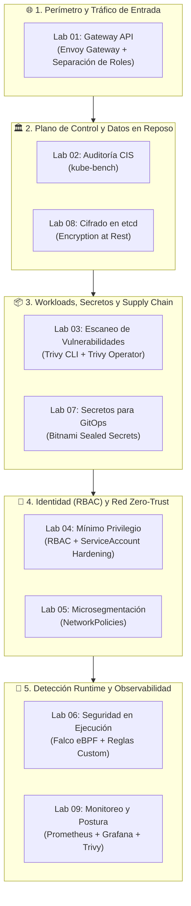

<div align="center">

# 🛡️ Blindando Kubernetes: Seguridad, Auditoría y Control Total

[](./02-kube-bench/README.md)
[](./01-gateway-api/README.md)
[](./03-trivy-k8s/README.md)
[](./09-monitoring-prometheus-grafana/README.md)
[](https://www.linkedin.com/in/edwin-bermudez-cuervo)

¡Bienvenido al repositorio oficial de laboratorios prácticos de **"Blindando Kubernetes: Seguridad, Auditoría y Control Total del Clúster"**! 🚀

Este repositorio está diseñado como una guía interactiva y paso a paso de **Defensa en Profundidad (Defense-in-Depth)** para que experimentes de primera mano con las herramientas estándar de la CNCF y las mejores prácticas de seguridad (*CKS / Hardening*) en entornos de producción.

</div>

---

## 🏗️ Arquitectura de Defensa en Profundidad (Los 9 Módulos)



---

## 📚 Ruta de Aprendizaje y Laboratorios (9 Módulos)

El aprendizaje está dividido en **9 módulos prácticos**. Aunque cada uno puede ejecutarse de forma independiente, seguirlos en orden te permite construir un clúster blindado de extremo a extremo:

| # | Laboratorio | Capa de Seguridad | Herramientas Clave | Guía Paso a Paso |
| :---: | :--- | :--- | :---: | :---: |
| **01** | **Kubernetes Gateway API** | Tráfico de Entrada y Separación de Roles | `Envoy Gateway` `HTTPRoute` | [🌐 Ir al Lab 01](./01-gateway-api/README.md) |
| **02** | **Auditoría CIS Benchmark** | Cumplimiento del Plano de Control y Nodos | `kube-bench` `CIS Benchmark` | [🛡️ Ir al Lab 02](./02-kube-bench/README.md) |
| **03** | **Escaneo de Vulnerabilidades y Misconfigurations** | Imágenes, `securityContext` y Registros Confiables | `Trivy CLI` `Trivy Operator` | [🔍 Ir al Lab 03](./03-trivy-k8s/README.md) |
| **04** | **RBAC y Mínimo Privilegio** | Autorización, Impersonación y Protección de Tokens | `Role` `ClusterRole` `SA` | [🔐 Ir al Lab 04](./04-rbac-minimum-privilege/README.md) |
| **05** | **Aislamiento con NetworkPolicies** | Microsegmentación y Red *Zero-Trust* | `NetworkPolicy` `CNI` | [🕸️ Ir al Lab 05](./05-network-policies/README.md) |
| **06** | **Detección en Tiempo de Ejecución (Runtime)** | Inspección de *Syscalls* y Caza de Crypto-Miners | `Falco` `Falcosidekick UI` | [🦅 Ir al Lab 06](./06-falco-overview/README.md) |
| **07** | **Gestión Segura de Secretos (GitOps)** | Cifrado Asimétrico y Scopes (`strict`, `ns`, `cluster`) | `Sealed Secrets` `kubeseal` | [🔑 Ir al Lab 07](./07-secrets-sealed/README.md) |
| **08** | **Cifrado de Datos en Reposo (etcd)** | Protección Criptográfica de `Secrets` en `etcd` | `EncryptionConfiguration` `etcdctl` | [🔒 Ir al Lab 08](./08-encryption-at-rest/README.md) |
| **09** | **Monitoreo Integral y Postura de Seguridad** | Observabilidad de Recursos y Dashboards de CVEs | `Prometheus` `Grafana` `ServiceMonitor` | [📊 Ir al Lab 09](./09-monitoring-prometheus-grafana/README.md) |

---

## 📁 Estructura del Repositorio

```text
blindando-kubernetes/
├── 📂 01-gateway-api/                   # Gestión moderna de tráfico de entrada con Envoy Gateway
├── 📂 02-kube-bench/                    # Auditoría CIS de nodos y componentes del Control Plane
├── 📂 03-trivy-k8s/                     # Escaneo de vulnerabilidades, políticas y hardening de workloads
├── 📂 04-rbac-minimum-privilege/        # Diseño de Roles, simulación de robo de token y remediación
├── 📂 05-network-policies/              # Políticas Default-Deny y apertura controlada entre Pods
├── 📂 06-falco-overview/                # Reglas personalizadas en Falco para detectar Crypto-Miners
├── 📂 07-secrets-sealed/                # Cifrado de secretos para GitOps y laboratorio de Scopes
├── 📂 08-encryption-at-rest/            # Cifrado de secretos en reposo en etcd (aescbc / KMS)
└── 📂 09-monitoring-prometheus-grafana/ # Observabilidad del clúster e integración con Trivy Operator
```

> 💡 **Tip de Aprendizaje:** Cada directorio contiene su propio archivo `README.md` detallado con explicaciones, comandos listos para copiar y todos los manifiestos YAML necesarios.

---

## ⚙️ Requisitos Previos

Para aprovechar al máximo estos laboratorios sin bloqueos técnicos, asegúrate de contar con:

1. **Entorno Kubernetes Funcional:**
   - Un entorno de laboratorio en la nube como [**iximiuz Labs**](https://labs.iximiuz.com/) o **Killercoda**.
   - O un clúster local (`minikube`, `kind`, `k3d`, `Rancher Desktop`) con un CNI que soporte `NetworkPolicies` (como **Cilium** o **Calico**).
2. **Herramientas Cliente:**
   - `kubectl` y `helm` (v3+) instalados y autenticados contra tu clúster.
   - Opcional según el módulo: `trivy` (Lab 03), `kubeseal` (Lab 07) y `etcdctl` en el nodo de control plane (Lab 08).
3. **Privilegios:**
   - Permisos de `cluster-admin` para instalar operadores, CRDs, configuraciones RBAC y políticas de red.

---

## 🚀 Cómo Empezar

1. **Clona el repositorio** en tu máquina o entorno de laboratorio:
   ```bash
   git clone https://github.com/edwinbermudez91/blindando-kubernetes.git
   cd blindando-kubernetes
   ```

2. **Verifica la conexión a tu clúster:**
   ```bash
   kubectl cluster-info
   kubectl get nodes
   ```

3. **¡Inicia el primer laboratorio!** Entra a [`01-gateway-api/README.md`](./01-gateway-api/README.md) y avanza módulo por módulo.

---

## 👨‍🏫 Autor y Comunidad

Material diseñado y mantenido por **Edwin Bermúdez** — *Senior DevOps & SRE | Cloud Native Instructor*.

- 🔗 **LinkedIn:** [linkedin.com/in/edwin-bermudez-cuervo](https://www.linkedin.com/in/edwin-bermudez-cuervo)
- 🐙 **GitHub:** [@edwinbermudez91](https://github.com/edwinbermudez91)
- 🚢 **Curso Fundamentos de Kubernetes:** [edwinbermudez91/Fundamentos-Kubernetes](https://github.com/edwinbermudez91/Fundamentos-Kubernetes)

*¡Es hora de blindar clústeres de principio a fin!* 🛡️☸️
